# BÁO CÁO ĐỒ ÁN

**Tên đề tài**

Xây dựng hệ thống e-commerce dạng marketplace (nhiều shop)  
theo kiến trúc Microservices với Spring Boot + Spring Cloud

| Mục | Nội dung |
|-----|----------|
| Sinh viên | Trịnh Văn Hải |
| Mã SV / lớp | *(điền)* |
| Giảng viên hướng dẫn | *(điền)* |
| Công nghệ | Java 21, Spring Boot 3, Spring Cloud, PostgreSQL, RabbitMQ, React |
| Package | `gtvt.haitv.ecommerce` |
| Năm | 2026 |

> Báo cáo thiết kế System Analysis cho **sàn thương mại điện tử nhiều gian hàng (MVP)** — hệ thống **Nava**. **Bộ tài liệu nộp:** [`docs/README.md`](docs/README.md) (đồng bộ: `python3 scripts/build_docs_from_bao_cao.py`; Word: `python3 scripts/build_bao_cao_docx.py`).

---

## Mục lục

1. [Tổng quan hệ thống](#1-tổng-quan-hệ-thống)
2. [Vấn đề và phạm vi MVP](#2-vấn-đề-và-phạm-vi-mvp)
3. [Tác nhân – Chức năng – Business Rules](#3-tác-nhân--chức-năng--business-rules)
4. [Quy trình nghiệp vụ (BPMN)](#4-quy-trình-nghiệp-vụ-bpmn)
5. [Kiến trúc Microservices](#5-kiến-trúc-microservices)
6. [Biểu đồ thiết kế](#6-biểu-đồ-thiết-kế)
7. [Thiết kế dữ liệu và API](#7-thiết-kế-dữ-liệu-và-api)
8. [Kịch bản kiểm thử và thuyết minh bảo vệ](#8-kịch-bản-kiểm-thử-và-thuyết-minh-bảo-vệ)
9. [Kết luận](#9-kết-luận)
10. [Phụ lục — Q&A bảo vệ](#phụ-lục--qa-bảo-vệ)

### Ánh xạ yêu cầu đề bài → mục báo cáo

| Yêu cầu thường gặp | Mục |
|--------------------|-----|
| Hệ thống / vấn đề gì | 1, 2 |
| Tác nhân – chức năng | 3 |
| Storefront (route, API UI) | 3.5, 5.6 |
| Quy trình BPMN | 4 |
| Kiến trúc Microservices | 1, 5 |
| Triển khai production (định hướng) | 5.7, 6.3 |
| Biểu đồ tiêu biểu | 6 |
| Dữ liệu / API / kiểm thử | 7, 8 |

### Thuật ngữ

| Thuật ngữ | Nghĩa trong đồ án |
|-----------|-------------------|
| Nava | Tên sàn thương mại điện tử (Storefront) của đồ án |
| Marketplace | Sàn nhiều gian hàng; Customer chọn shop rồi mới mua hàng |
| Shop / Kênh người bán | Gian hàng; khu vực Seller quản lý shop sau khi được duyệt (Seller Center) |
| Microservice | Dịch vụ nhỏ, deploy độc lập, một Bounded context |
| API Gateway | Cổng vào duy nhất cho Storefront (`api-gateway`) |
| Service Discovery | Eureka |
| Database per service | Mỗi service một Logical database; không FK xuyên service |
| Bounded context | Ranh giới miền (Auth, Shop, Catalog, Order, …) |
| Saga / Orchestrator | Checkout do `order-service` điều phối; fail thì Compensation |
| Eventual consistency | Notification có thể đến sau Order |
| JWT / BCrypt | Xác thực; mật khẩu hash |
| Oversell | Bán vượt tồn — chống bằng reserve trước thanh toán |
| Snapshot | Lưu tên/giá SP (VND) và tên shop trên Order tại lúc đặt |
| VND | Đơn vị tiền tệ hiển thị và lưu giá sản phẩm |
| Mock payment | Thanh toán giả lập SUCCESS / FAILED (mỗi Order) |
| Reserve / Release / Deduct | Giữ hàng / hoàn tồn / trừ tồn |
| Golden Path | Luồng thành công xuyên suốt (mua trong shop + đăng ký shop) |
| Storefront | Giao diện khách (React) — thư mục `frontend/`, tên sản phẩm **Nava** |
| SPA | Single Page Application — React + Vite, điều hướng client không reload trang |
| Protected route | Route bọc `ProtectedRoute`: bắt login và/hoặc role CUSTOMER / SELLER / PLATFORM_ADMIN |
| Idempotency | Gọi lại cùng request (retry) không tạo side-effect trùng (đơn, trừ kho) |
| Transactional Outbox | Ghi event vào DB cùng transaction nghiệp vụ; worker relay sang MQ — tránh mất message |

---

# 1. Tổng quan hệ thống

## 1.1 Hệ thống là gì

Đồ án xây **Nava** — hệ thống thương mại điện tử dạng **marketplace (nhiều gian hàng)** theo kiến trúc **Microservices** (Spring Boot + Spring Cloud), mức **MVP**.

Hệ thống cho phép:

- **Customer** xem danh sách shop trên Home, **vào một shop** (URL theo `shopId`), xem **danh sách sản phẩm** (lọc category tùy chọn), thêm giỏ (group theo shop), checkout, theo dõi / hủy đơn hợp lệ.
- **Seller** đăng ký mở shop → chờ duyệt → quản lý danh mục / sản phẩm / tồn / đơn **của shop mình** (Kênh người bán).
- **Platform Admin** duyệt / từ chối / khóa shop; **tổng quan GMV và doanh thu theo gian hàng**; quản lý khách hàng (MVP — không màn hình xử lý đơn toàn sàn trên UI).
- Thanh toán **Mock payment** theo từng Order; thông báo **bất đồng bộ** qua RabbitMQ. Giá hiển thị **VND**.

**Luồng mua chính:** Home (list shop) → chọn shop → danh sách SP trong shop → chi tiết SP → giỏ → checkout.  
Customer **không** mua từ catalog “tất cả SP mọi shop” như cửa hàng đơn.

Frontend chỉ gọi **API Gateway**. Shop là Bounded context riêng: **`shop-service`** + **`shop_db`**.

## 1.2 Hình 1.1 — Architecture overview

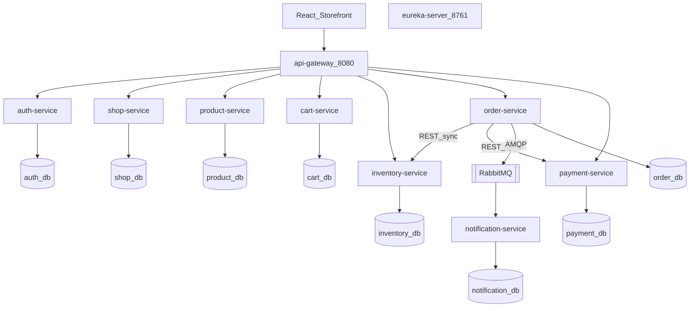

**Đọc hình**

- Storefront chỉ biết Gateway; Eureka cung cấp Service Discovery.
- `shop-service` là nguồn sự thật về gian hàng (đăng ký, duyệt, list Home).
- `product-service` quản lý category/SP theo `shopId` (logical ID, không FK sang `shop_db`).
- Checkout: mỗi Order thuộc một shop; Order → Inventory → Payment (Saga); sau đó event → Notification.

## 1.3 Catalog dịch vụ

| Service | Port | Logical DB | Trách nhiệm | Vai trò trong hệ thống |
|---------|------|------------|-------------|------------------------|
| `api-gateway` | 8080 | — | Route `/api/**`, CORS | **Edge** |
| `eureka-server` | 8761 | — | Đăng ký / khám phá service | **Service Discovery** |
| `auth-service` | 8081 | auth_db | Register, login, JWT; role CUSTOMER / SELLER / PLATFORM_ADMIN | **Identity & Access** |
| `shop-service` | 8089 | shop_db | Đăng ký shop, duyệt/khóa, list/chi tiết shop public | **Shop registry** — SoT gian hàng |
| `product-service` | 8082 | product_db | Category + product theo `shopId` | **Catalog trong shop** |
| `cart-service` | 8083 | cart_db | Giỏ; item kèm `shopId` | **Pre-order** (group theo shop) |
| `inventory-service` | 8084 | inventory_db | check / reserve / release / deduct | **Stock integrity** |
| `order-service` | 8085 | order_db | Split Order theo shop; Snapshot; hủy; fulfillment | **Saga Orchestrator** |
| `payment-service` | 8086 | payment_db | Mock charge SUCCESS / FAILED | **Mock payment** (per Order) |
| `notification-service` | 8087 | notification_db | Consume event | **Side-effect** async |

## 1.4 Giao tiếp sync / async

| Kiểu | Đường đi | Mục đích |
|------|----------|----------|
| Sync (REST) | Client → Gateway → Service; Order → Inventory; Order → Payment | Checkout cần kết quả ngay |
| Async (AMQP) | Order → RabbitMQ → Notification | Tách thông báo khỏi transaction đơn |

## 1.5 Information Architecture Storefront (Nava)

**Luồng mua (tóm tắt)**

| Bước | Route | Hành vi |
|------|-------|---------|
| 1 | `/` | **Danh sách shop** `APPROVED` (tên, logo, mô tả); tìm shop theo tên |
| 2 | `/shops/:shopId` | Vào **một shop** theo mã ổn định; **list SP** (lọc category tùy chọn) |
| 3 | `/shops/:shopId/products/:id` | Chi tiết SP trong context shop → thêm giỏ |
| 4 | `/cart` | Giỏ **group theo shop** (mỗi block một shop) |
| 5 | `/checkout` | Checkout → **N Order** (1 Order / shop); mỗi Order một Saga + Mock payment |

**Toàn bộ route (`App.jsx`)**

| Nhóm | Route | Bảo vệ | Mục đích |
|------|-------|--------|----------|
| Công khai | `/`, `/shops/:shopId` | — | Home, catalog trong shop |
| Công khai | `/shops/:shopId/products/:id`, `/products/:id` | — | PDP (context shop hoặc legacy) |
| Công khai | `/shops/:shopId/products` | — | Redirect legacy → `/shops/:shopId` |
| Xác thực | `/login`, `/register` | — | JWT; login có thể flush giỏ pending |
| Xác thực | `/forgot-password`, `/reset-password` | — | Khôi phục mật khẩu |
| Customer | `/cart`, `/checkout`, `/orders`, `/orders/:id` | CUSTOMER | Giỏ, checkout, đơn |
| Customer | `/notifications` | CUSTOMER | Thông báo async (badge trên Layout) |
| Chung | `/profile` | Login | Hồ sơ |
| Seller | `/register-shop` | Login | Gửi hồ sơ shop |
| Seller | `/seller` | SELLER | Kênh người bán (sau APPROVED) |
| Admin | `/admin` | PLATFORM_ADMIN | Duyệt shop, giám sát sàn |

> `shopId` dùng cho điều hướng Storefront. Trường `slug` chỉ phục vụ hồ sơ (unique), không phải khóa URL chính. Chi tiết ánh xạ FR → API: mục **3.5**; kiến trúc UI: mục **5.6**.

## 1.6 Golden Path

### Hình 1.2a — Mua hàng

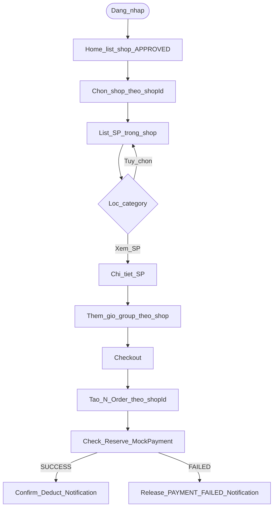

**Đọc hình:** Vào shop là xem list sản phẩm; category chỉ là bộ lọc. Mỗi shop một Order và một vòng Saga riêng.

### Hình 1.2b — Mở shop

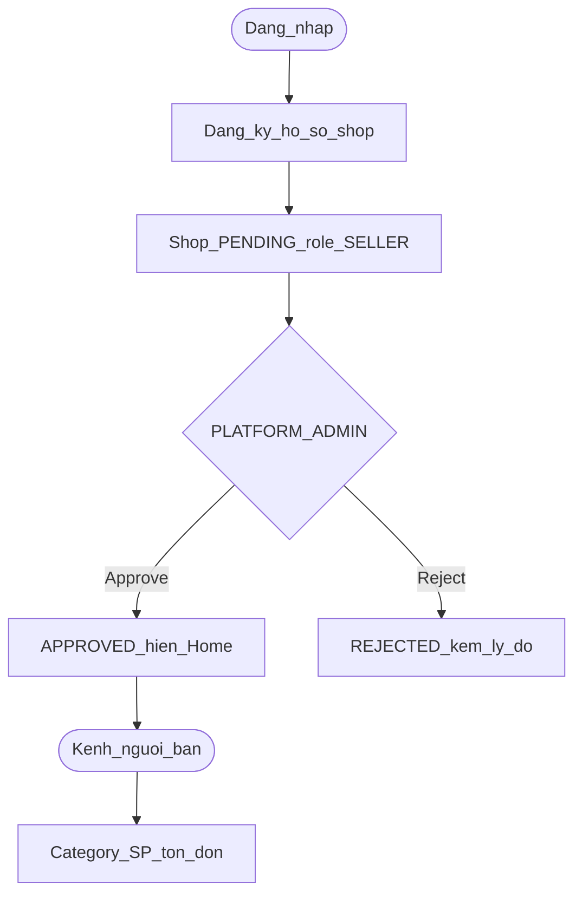

**Đọc hình:** Shop chỉ bán và hiện Home sau khi được duyệt. Seller quản lý gian hàng trong Kênh người bán.

---

# 2. Vấn đề và phạm vi MVP

## 2.1 Vấn đề cần giải quyết

| # | Vấn đề | Cách hệ thống xử lý |
|---|--------|---------------------|
| 1 | Nhiều người bán trên một sàn | `shop-service`; mỗi SP gắn `shopId` |
| 2 | Shop chưa duyệt đã bán | Chỉ shop `APPROVED` hiện Home / cho bán |
| 3 | Customer lạc giữa hàng nghìn SP | Bắt buộc vào shop → list SP (lọc category tùy chọn) |
| 4 | Giỏ nhiều shop | Group theo shop; checkout **split** N Order |
| 5 | Oversell | Reserve trước pay; tồn không âm |
| 6 | Payment fail | Compensation: Release stock |
| 7 | Giá / shop đổi sau đặt | Snapshot SP + `shop_name` trên Order |
| 8 | Thông báo lỗi phá đơn | Notification async (BR-12) |
| 9 | Quyền lẫn lộn | JWT + CUSTOMER / SELLER / PLATFORM_ADMIN; Seller chỉ scope shop mình |

## 2.2 Phạm vi MVP

**Trong phạm vi**

- Đăng ký / duyệt / khóa shop (`shop-service`).
- Home = list shop; mua trong context shop (list SP, lọc category tùy chọn).
- Kênh người bán: category, product, inventory, đơn shop.
- Cart group shop; checkout N Order; Saga; Mock payment; Notification; giá VND.
- API Gateway, Eureka, Database per service, Storefront React (Nava).

**Ngoài phạm vi** (cắt gọn cho đồ án)

Livestream, ví sàn thật, affiliate, chat buyer–seller, rating đầy đủ, voucher phức tạp, logistics đối tác, quảng cáo shop, **tìm kiếm catalog toàn sàn** như luồng chính, hoa hồng / escrow, thanh toán gộp một lần cho nhiều shop.

## 2.3 Nguyên tắc đồ án

> Đủ nghiệp vụ sàn thật để bảo vệ. Đủ gọn để minh họa Microservices end-to-end.

---

# 3. Tác nhân – Chức năng – Business Rules

## 3.1 Tác nhân

| ID | Tác nhân | Loại | Vai trò |
|----|----------|------|---------|
| ACTOR-01 | Customer | Chính | Người mua — vào shop rồi mới chọn hàng |
| ACTOR-02 | Seller | Chính | Chủ shop — đăng ký, quản lý gian hàng |
| ACTOR-03 | Platform Admin | Chính | Duyệt/khóa shop; tổng quan doanh thu shop; khóa tài khoản khách |
| ACTOR-04 | Payment System | Phụ (mock) | SUCCESS / FAILED per Order |
| ACTOR-05 | Notification System | Phụ | Consume event |
| ACTOR-06 | Hạ tầng | Phụ | Eureka, Gateway, PostgreSQL, RabbitMQ |

## 3.2 Customer — chức năng

| Mã | Chức năng | Mô tả |
|----|-----------|-------|
| FR-01 | Đăng ký / đăng nhập | Email unique, BCrypt, JWT; role mặc định CUSTOMER |
| FR-02 | Xem list shop (Home) | Chỉ shop `APPROVED`; tìm theo tên |
| FR-03 | Vào shop | Mở `/shops/{shopId}` — list SP của shop |
| FR-04 | Lọc loại hàng trong shop | Category thuộc `shopId` (tùy chọn trên list) |
| FR-05 | Xem / chọn SP trong shop | List + PDP scoped `shopId` (+ `categoryId` nếu lọc) |
| FR-06 | Quản lý giỏ | Thêm / sửa / xóa; UI group theo shop |
| FR-07 | Checkout | Tạo N Order (1 / shop); địa chỉ + phương thức TT |
| FR-08 | Xem / hủy đơn | Chỉ đơn của mình; hủy khi trạng thái hợp lệ |
| FR-09 | Theo dõi đơn | PENDING → … → DELIVERED / CANCELLED / PAYMENT_FAILED |

Customer **không** CRUD shop / category / product.

## 3.3 Seller — chức năng (đăng ký shop & Kênh người bán)

| Mã | Chức năng | Mô tả |
|----|-----------|-------|
| FR-S01 | Mở form đăng ký shop | `/register-shop` — cần login |
| FR-S02 | Gửi hồ sơ shop | Tên, slug (unique hồ sơ), mô tả, logo URL → `PENDING` |
| FR-S03 | Gán Owner + role | `shop_members` OWNER; user → role `SELLER` |
| FR-S04 | Xem trạng thái hồ sơ | PENDING / REJECTED (+ lý do) / APPROVED / SUSPENDED |
| FR-S05 | Sửa hồ sơ shop | Sau APPROVED — tên, mô tả, logo (phạm vi cho phép); URL Storefront vẫn theo `id` |
| FR-S06 | Kênh người bán — category | CRUD category **trong shop** |
| FR-S07 | Kênh người bán — product | CRUD SP scoped `shopId` |
| FR-S08 | Kênh người bán — tồn kho | Cập nhật tồn SP của shop |
| FR-S09 | Kênh người bán — đơn | Xem / đổi trạng thái fulfillment đơn **của shop mình** |
| FR-S10 | Thống kê seller | `GET /orders/seller-stats?shopId=&days=` (alias `/orders/seller/stats`) |

MVP: một user Owner tối đa **một** shop đang `PENDING` hoặc `APPROVED`.

## 3.4 Platform Admin — chức năng

| Mã | Chức năng | Mô tả |
|----|-----------|-------|
| FR-A01 | Đăng nhập | Role PLATFORM_ADMIN |
| FR-A02 | Duyệt shop | `APPROVED` → hiện Home |
| FR-A03 | Từ chối shop | `REJECTED` + `reject_reason` |
| FR-A04 | Khóa shop | `SUSPENDED` — ẩn Home, không bán |
| FR-A05 | Tổng quan doanh thu sàn | GMV + bảng **doanh thu theo shop** (aggregate từ `GET /admin/orders`, đơn CONFIRMED→DELIVERED) |
| FR-A06 | Quản lý khách hàng | Khóa / mở khóa tài khoản CUSTOMER |

Platform Admin **không** đăng SP hộ Seller (MVP). **Không** có trang `/admin/orders` trên Storefront (API admin orders vẫn tồn tại phục vụ thống kê).

## 3.5 Ánh xạ chức năng → Storefront (Nava)

Storefront (`frontend/`) triển khai các FR ở mục 3.2–3.4. Mọi HTTP đi qua **`/api`** (dev: Vite proxy → Gateway `:8080`). Envelope JSON thống nhất mục 7.2.

### Bảng 3.5.1 — Customer

| FR | Route | Page (component) | API chính qua Gateway |
|----|-------|------------------|------------------------|
| FR-01 | `/register`, `/login` | `RegisterPage`, `LoginPage` (cổng **khách**) | `POST /auth/register`, `POST /auth/login` |
| — | `/admin/login` | `AdminLoginPage` | Chỉ `PLATFORM_ADMIN` → `/admin` |
| — | `/seller/login` | `SellerLoginPage` | Chỉ `SELLER` → `/seller` / `/register-shop` |
| FR-01 | `/forgot-password`, `/reset-password` | `ForgotPasswordPage`, `ResetPasswordPage` | `POST /auth/forgot-password`, `POST /auth/reset-password` |
| FR-02 | `/` | `HomePage` | `GET /shops?status=APPROVED&q=` |
| FR-03–05 | `/shops/:shopId` | `ShopProductListPage` | `GET /shops/id/{shopId}`, `GET /products?shopId=`, `GET /products/categories?shopId=` |
| FR-05 | `.../products/:id`, `/products/:id` | `ProductDetailPage` | `GET /products/{id}`; thêm giỏ: `POST /cart/items` |
| FR-06 | `/cart` | `CartPage` | `GET /cart`, `PUT /cart/items/{id}`, `DELETE /cart/items/{id}`, `DELETE /cart`; enrich `GET /products/{id}`, `GET /shops/id/{shopId}` |
| FR-07 | `/checkout` | `CheckoutPage` | `POST /orders` (body: địa chỉ, `paymentMethod`, `simulatePaymentFailure` demo Saga) |
| FR-08–09 | `/orders`, `/orders/:id` | `OrderListPage`, `OrderDetailPage` | `GET /orders`, `GET /orders/{id}`, `POST /orders/{id}/cancel` |
| — | `/notifications` | `NotificationsPage` | `GET /notifications` (Layout poll badge khi đăng nhập) |
| — | `/profile` | `ProfilePage` | Đọc profile từ JWT/local; liên kết thông báo |

**Ghi chú UI:** `CartPage` gom dòng giỏ theo `shopId` (Map) — chuẩn bị tâm lý checkout **N Order** (BR-MV-04). Khách chưa login có thể lưu SP vào **pending cart** (localStorage); sau login `LoginPage` gọi `POST /cart/items`.

### Bảng 3.5.2 — Seller & Platform Admin

| FR | Route | Page | API chính |
|----|-------|------|-----------|
| FR-S01–02 | `/register-shop` | `RegisterShopPage` | `POST /shops` |
| FR-S03–04 | `/seller` | `SellerLayout` + `SellerOverview` | `GET /shops/me`; dashboard KPI + `GET /orders/seller-stats?shopId=&days=7` |
| FR-S06–08 | `/seller/products`, `/categories`, `/inventory` | `SellerProductsPage`, … | CRUD product/category; `PUT /inventory/{productId}` |
| FR-S09 | `/seller/orders`, `/seller/orders/:id` | `SellerOrdersPage`, `SellerOrderDetailPage` | `GET /orders/seller?shopId=`; fulfillment PATCH |
| FR-S — | `/seller/settings` | `SellerSettingsPage` | `PUT /shops/me` |
| FR-S02b | `/register-shop` | `RegisterShopPage` | `contactEmail` bắt buộc |
| FR-A05 | `/admin` | `AdminLayout` → `AdminOverview` | KPI GMV; bảng doanh thu theo shop; `GET /admin/orders`, `/admin/shops`, `/admin/users` |
| FR-A02–04 | `/admin/shops`, `/admin/shops/:shopId` | `AdminShopsPage`, `AdminShopDetailPage` | Duyệt/từ chối/tạm ngưng; chi tiết — doanh thu shop + xem nhanh SP |
| FR-A06 | `/admin/customers` | `AdminCustomersPage` | `PATCH /admin/users/{id}/status` |
| — | `/admin/orders` | *(redirect → `/admin`)* | Legacy URL; không còn UI quản lý đơn admin |

### Quy tắc hiển thị (BR-UI)

| ID | Quy tắc | Triển khai |
|----|---------|------------|
| BR-UI-01 | SELLER không dùng luồng mua | `ProtectedRoute role=CUSTOMER` → redirect `/seller` |
| BR-UI-02 | PDP với SELLER | Không buy-box; CTA theo shop của mình vs shop khác |
| BR-UI-03 | Header SELLER | Ẩn giỏ, thông báo, “Đơn hàng”, “Đăng ký bán”; có “Xem vitrine” |
| BR-UI-04 | Đơn bán | Link `/seller/orders/:id?shopId=` — không `/orders/:id` |
| BR-UI-05 | Đăng ký bán | Ẩn khi đã `SELLER` (Layout, Home) |
| BR-UI-06 | MK tạm | Login SELLER + `mustChangePassword` → `/change-password` |
| BR-UI-07 | Admin login | Quản trị **chỉ** `/admin/login` — `/login` từ chối admin |
| BR-UI-08 | Shop APPROVED | `/register-shop` → redirect `/seller`; onboarding trong `/seller` |
| BR-UI-09 | Sandbox route | Sau login: ADMIN chỉ `/admin*`; SELLER chỉ `/seller*` + `/change-password`; CUSTOMER không vào `/admin*`/`/seller*` |
| BR-UI-10 | Đồng bộ role | Sau `POST /shops` gọi `refreshProfile()`; F5 có token → `GET /auth/profile`; seller không quản lý qua PDP vitrine |
| — | Theme | Storefront (cam) · `/admin/*` **Platform Console** (`PlatformShell`, sidebar tối) · merchant: `/seller/*` (`MerchantShell`) |
| — | Shop PENDING | `RegisterShopPage` / `SellerOnboarding` — chưa sidebar CRUD đầy đủ |
| — | Home guest | CTA: đăng nhập khách · người bán · quản trị sàn |

## 3.6 Business Rules

| ID | Quy tắc |
|----|---------|
| BR-01 | Email unique |
| BR-02 | Password BCrypt; không trả về client |
| BR-03 | Chỉ Seller (Owner/Staff ACTIVE) CRUD category/SP của shop mình |
| BR-04 | Customer chỉ xem dữ liệu đơn/giỏ của mình |
| BR-05 | Giỏ rỗng không checkout |
| BR-06 | Không đủ hàng → không tạo Order thành công |
| BR-07 | Không Oversell; tồn không âm |
| BR-08 | Payment SUCCESS mới confirm Order |
| BR-09 | Payment FAILED phải Release stock |
| BR-10 | OrderItem Snapshot giá; Order Snapshot `shop_name` |
| BR-11 | Chỉ hủy ở trạng thái hợp lệ |
| BR-12 | Notification fail không rollback Order |
| BR-MV-01 | Chỉ shop `APPROVED` xuất hiện trên Home và cho phép bán |
| BR-MV-02 | Mọi product/category thuộc đúng một `shopId` |
| BR-MV-03 | Luồng mua chính: chọn shop → list SP (lọc category tùy chọn); không catalog toàn sàn |
| BR-MV-04 | Checkout: một Order chỉ thuộc một shop; giỏ đa shop → N Order |
| BR-MV-05 | Seller chỉ truy cập dữ liệu shop mình; Admin duyệt shop qua `shop-service` |
| BR-MV-06 | Shop `SUSPENDED` / `REJECTED` / `PENDING` không hiện Home |

---

# 4. Quy trình nghiệp vụ (BPMN)

## 4.1 BPMN-01 — Đăng ký / Đăng nhập

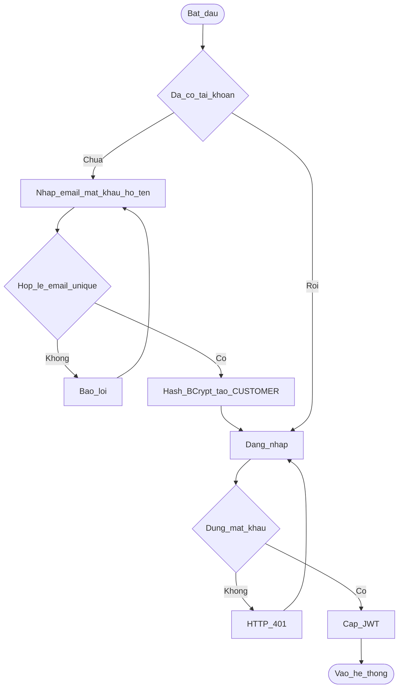

**Đọc hình:** JWT mang `userId` + `role` (CUSTOMER / SELLER / PLATFORM_ADMIN).

## 4.2 BPMN-02 — Đăng ký shop và duyệt (trọng tâm marketplace)

**Hình 4.1 — Đăng ký & duyệt shop**

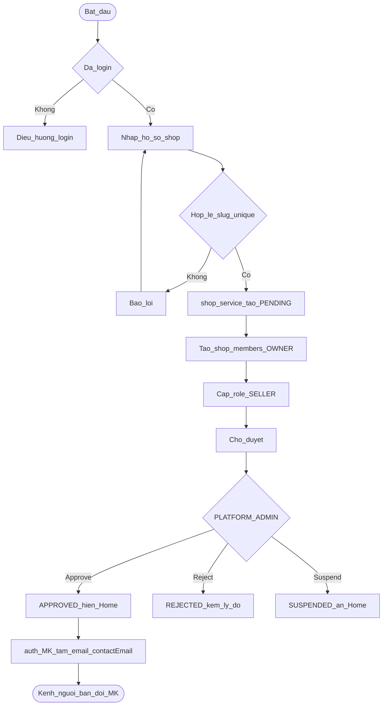

**Đọc hình**

- `shop-service` tạo shop `PENDING`; chưa hiện Home; hồ sơ có `contactEmail`.
- Approve → `APPROVED` + gọi `auth-service` (mật khẩu tạm, `mustChangePassword`) + email template tới `contactEmail` (best-effort).
- Seller đăng nhập lần đầu → `/change-password` → `/seller` (dashboard merchant).
- Reject / Suspend → **không** gửi email credential; Customer không thấy shop trên Home.

## 4.3 BPMN-03 — Mua hàng trong shop (Home → shop → list SP)

**Hình 4.2 — Hành trình mua trên Storefront**

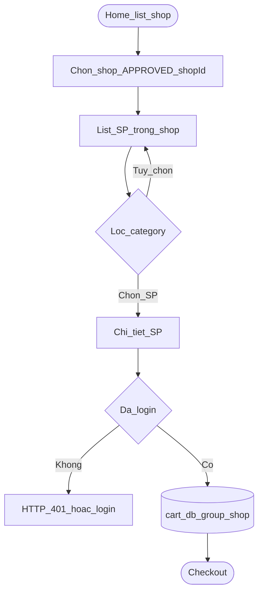

**Đọc hình:** Home không liệt kê SP thay shop. Vào shop theo `shopId` là thấy list SP; category là bộ lọc tùy chọn.

## 4.4 BPMN-04 — Giỏ hàng

Mỗi Customer một giỏ. Item lưu `shopId`. UI group theo shop.

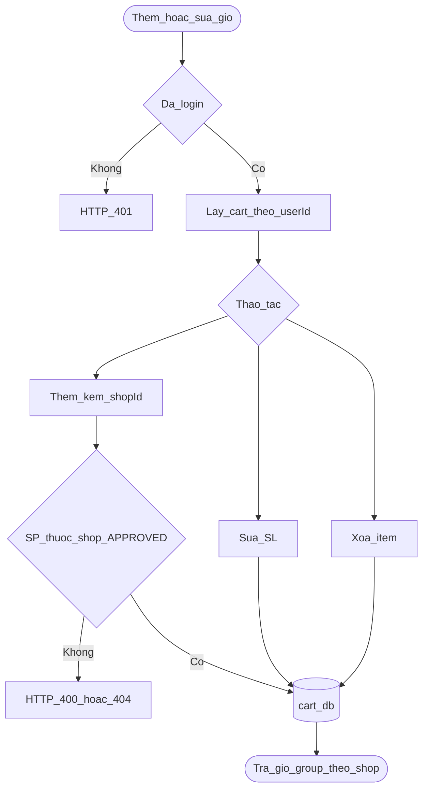

## 4.5 BPMN-05 — Checkout + Saga (split theo shop)

**Hình 4.3 — Checkout split N Order**

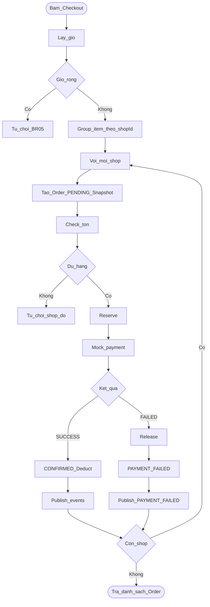

**Đọc hình**

- Một request checkout có thể tạo **nhiều Order**; mỗi Order một Saga độc lập.
- Fail một shop không bắt buộc rollback shop khác (MVP: mỗi shop xử lý riêng; báo rõ từng Order).
- `order-service` = Saga Orchestrator; không 2PC xuyên DB.

### Fulfillment (rút gọn)

Seller (hoặc Platform Admin) đổi PROCESSING → SHIPPING → DELIVERED cho Order của đúng shop; có thể publish event Notification.

---

# 5. Kiến trúc Microservices

## 5.1 Lựa chọn

| | Modular Monolith | Microservices (chọn) |
|--|------------------|----------------------|
| Deploy | Một ứng dụng | Nhiều service |
| Database | Thường một DB | Database per service |
| Shop vs Catalog | Dễ dính chặt | Tách `shop-service` / `product-service` |
| Phù hợp Spring Cloud | Khó triển khai | Gateway, Eureka, MQ |

## 5.2 Vì sao chọn Microservices + tách shop-service

1. Đề tài Spring Boot + Spring Cloud.
2. **Vòng đời shop** (đăng ký, duyệt, khóa) khác **catalog** (category/SP) → Bounded context riêng.
3. Checkout cần sync Saga + async Notification.
4. Dễ bảo vệ: ownership theo `shopId`, không FK xuyên DB.
5. Hướng mở rộng: scale đọc list shop / catalog độc lập.

## 5.3 Khái niệm áp dụng

| Thuật ngữ | Trong đồ án |
|-----------|-------------|
| Bounded context | Auth, Shop, Product, Cart, Inventory, Order, Payment, Notification |
| API Gateway | `api-gateway` |
| Service Discovery | `eureka-server` |
| Database per service | Tám Logical database nghiệp vụ (+ infra) |
| Saga | Orchestration tại `order-service` (per Order / shop) |
| Eventual consistency | Notification |

## 5.4 Ưu / nhược và cách giảm phức tạp

**Ưu:** ranh giới shop rõ; duyệt shop không làm phình product-service; lỗi notification không phá Order.

**Nhược:** thêm service/DB; validate shop APPROVED khi đăng SP cần quy ước sync (gọi shop-service hoặc kiểm tra status trước khi ACTIVE).

**Giảm phức tạp MVP:** một PostgreSQL host nhiều Logical database; Mock payment; không hoa hồng / ví seller.

## 5.5 Công nghệ

| Tầng | Công nghệ |
|------|-----------|
| Backend | Java 21, Spring Boot 3, Spring Cloud, Spring Security, JPA |
| Gateway / Discovery | Spring Cloud Gateway, Eureka |
| DB | PostgreSQL — Logical database per service |
| Message | RabbitMQ |
| Frontend | React 18, Vite, React Router v6, Axios |

Storefront bổ sung: **React Context** (Auth, Cart, Dialog); **Axios interceptors** (JWT, 401, map message); dev server `:5173` proxy `/api` → Gateway (mục 5.6).

## 5.6 Thiết kế tầng giao diện (React Storefront)

### 5.6.1 Vai trò trong kiến trúc

Storefront là **SPA** — một bundle React, điều hướng phía client. Ứng dụng **chỉ biết Edge**: mọi nghiệp vụ qua `services/api.js` với `baseURL: "/api"`. Trong môi trường dev, Vite proxy tới `http://localhost:8080` (Gateway); production MVP giả định reverse proxy cùng origin — **không** gọi trực tiếp port `8081`–`8089`.

### 5.6.2 Cấu trúc mã nguồn (`frontend/src/`)

| Thư mục | Trách nhiệm |
|---------|-------------|
| `pages/` | Màn hình gắn route: Home, Shop, Cart, Checkout, Seller, Admin, Auth… |
| `components/` | `Layout` (header/nav), `ProtectedRoute`, `ProductCard`, `OrderTimeline`, `Feedback` |
| `context/` | `AuthContext` (JWT, role), `CartContext` (giỏ + badge count), `DialogContext` (confirm/toast) |
| `services/` | `api.js` — HTTP client duy nhất |
| `constants/` | Role, status, timeout, `MessageConstant` / `resolveUserMessage` |
| `utils/` | `catalog.js` (VND, nhãn trạng thái), `pendingCart`, `notifyRead` |

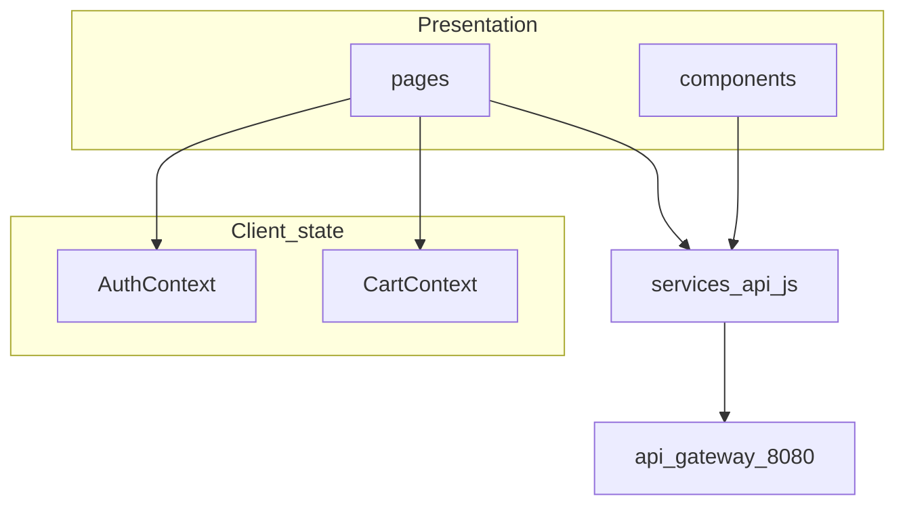

### 5.6.3 Xác thực và phiên

- **Login / Register:** `AuthContext` lưu `accessToken` và profile user trong `localStorage`; mọi request (trừ auth public) gắn header `Authorization: Bearer …`.
- **401:** interceptor xóa token, phát event hết phiên — tránh UI hiển thị như còn đăng nhập.
- **Phân quyền route:** `ProtectedRoute` theo role (mục 3.5); Admin không dùng giỏ Customer.

### 5.6.4 Luồng dữ liệu tiêu biểu

**Checkout (FR-07):** `CheckoutPage` lấy giỏ từ `CartContext` → `POST /orders` → điều hướng `OrderDetailPage` với `state.justPlaced` và danh sách Order (N shop → N phần tử) — khớp Saga mục 1.6.

**Giỏ đa shop:** `CartPage` group item theo `shopId`, lazy load tên shop và thông tin SP để hiển thị; **split Order** vẫn do `order-service` khi checkout.

**Hình 5.6 — Sequence UI Checkout (rút gọn)**

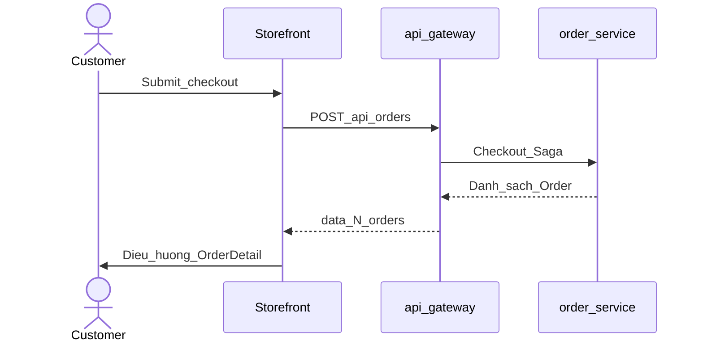

### 5.6.5 Xử lý lỗi và UX

- Lỗi API map sang câu tiếng Việt qua `resolveUserMessage`; UI **không** hiển thị mã lỗi thô cho end user.
- `Loading`, `Empty`, `ErrorBanner`, `ErrorBoundary` — pattern thống nhất trên pages.

### 5.6.6 Giới hạn MVP (frontend)

- Không SSR/SEO sâu; layout/style tập trung qua `Layout` và CSS class chung.
- File `ProductListPage.jsx` **legacy** — không gắn route trong `App.jsx`; luồng chính luôn qua shop (BR-MV-03).
- Admin console (`AdminLayout` + `PlatformShell`) — tổng quan GMV/doanh thu shop, duyệt gian hàng, khách hàng; catalog SP do Seller (`shopId`).

## 5.7 Giới hạn MVP và định hướng triển khai production

MVP chạy **môi trường dev** (Docker Compose, một instance/service). Kiến trúc nghiệp vụ (Gateway, database-per-service, Saga tại `order-service`, AMQP cho Notification) **đủ demo và bảo vệ**; **chưa production-grade** về HA, zero-downtime deploy và observability tập trung.

| Hạng mục | Hiện trạng MVP | Bổ sung khi go-live (ưu tiên) |
|----------|----------------|-------------------------------|
| Schema DB | JPA `ddl-auto: update` | **Flyway/Liquibase** — migration có version |
| Deploy | Script / rebuild container | **CI/CD** + **rolling update**; **readiness** tách **liveness** |
| Saga checkout | Orchestration REST + compensate | **Idempotency-Key** trên checkout; timeout + **circuit breaker** (Feign) |
| Event Notification | Publish Rabbit **sau commit** | **Transactional Outbox** + relay worker |
| HA hạ tầng | Postgres / Rabbit / Eureka single node | DB/MQ managed; backup **PITR**; discovery theo orchestrator (K8s/ECS) |
| Observability | Log + `X-Correlation-Id` | **OpenTelemetry** (trace) + **Prometheus/Grafana** (metric/SLO) |
| Edge | JWT validate tại từng service | (Tuỳ chọn) JWT/rate limit tại Gateway |

**Messaging:** giữ **RabbitMQ** cho side-effect (thông báo). Chỉ cân nhắc **Kafka** khi có nhiều consumer độc lập (audit, search, BI) cần **replay log** — ngoài phạm vi MVP Nava.

### 5.7.1 Case study ngắn (thực tế → GTVT)

**Case 1 — Marketplace: tách đơn theo seller (mô hình sàn đa gian hàng)**  
Một giỏ nhiều shop → **N đơn**; mỗi đơn một chuỗi reserve → charge → confirm; shop A lỗi thanh toán **không** rollback shop B. GTVT map trực tiếp: split Order theo `shopId` + Saga tại `order-service` (BPMN-05). Khi lên prod, rủi ro thường gặp là **retry checkout** sau timeout → cần **idempotency** và reserve/release **idempotent**.

**Case 2 — DB đã commit, message không tới (Transactional Outbox)**  
Order **COMMITTED** nhưng bước gửi RabbitMQ fail (broker/network) → khách có đơn, **không** email/thông báo. GTVT dùng publish **afterCommit** — đúng hướng tách transaction, nhưng chưa Outbox → có thể **at-most-once** trên đường MQ. Chuẩn ngành: ghi event vào bảng **outbox** cùng transaction Order; worker relay sang RabbitMQ.

### 5.7.2 So sánh messaging (tóm tắt)

| | **RabbitMQ (đồ án)** | **Kafka** |
|--|----------------------|-----------|
| Vai trò | Task queue / notify | Event log, nhiều consumer, replay |
| Phù hợp Nava | Order → Notification (một consumer) | Audit, search, analytics đa team |
| Ghi chú vận hành | Nên kèm **Outbox** + **DLQ** | Ops phức tạp hơn; không bắt buộc cho MVP |

Chi tiết kỹ thuật triển khai local: `docs/12-deployment.md`, `docs/15-spring-cloud-luong-chay-va-config.md`.

---

# 6. Biểu đồ thiết kế

## 6.1 Hình 2.1 — System Context

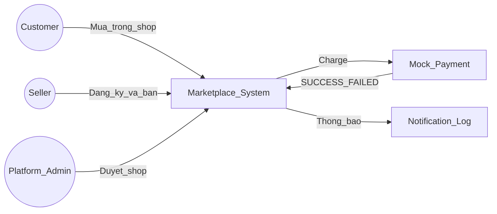

## 6.2 Hình 3.1 — Use Case

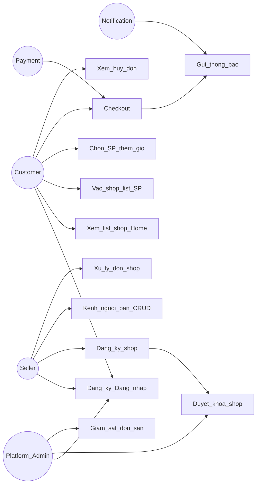

## 6.3 Deployment

**Dev (MVP hiện tại)**

- Frontend `:5173`
- Gateway `:8080`, Eureka `:8761`
- auth `:8081`, product `:8082`, cart `:8083`, inventory `:8084`, order `:8085`, payment `:8086`, notification `:8087`, **shop `:8089`** (admin-server giữ `:8088`)
- PostgreSQL `:5432`, RabbitMQ `:5672`
- Engine: `scripts/ops-deploy.sh` (Maven trong container + `docker compose up`)

**Production (định hướng — mục 5.7)**

- Storefront: build static (Vite) + CDN/reverse proxy; API chỉ qua Gateway (HTTPS).
- Microservice: orchestrator (K8s/ECS), **rolling deploy**, secret qua vault/env; **không** `ddl-auto: update` trên prod.
- Data: Postgres/RabbitMQ managed, backup có kiểm thử restore; correlation id + trace/metric tập trung.

## 6.4 Hình 5.1 — Sequence đăng ký & duyệt shop

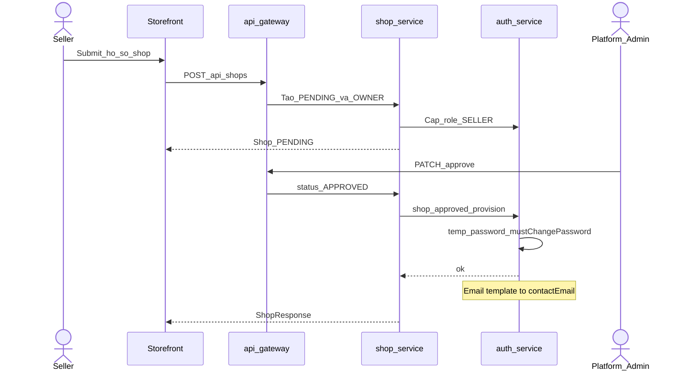

## 6.5 Hình 5.2 — Sequence Checkout + Saga (một Order / shop)

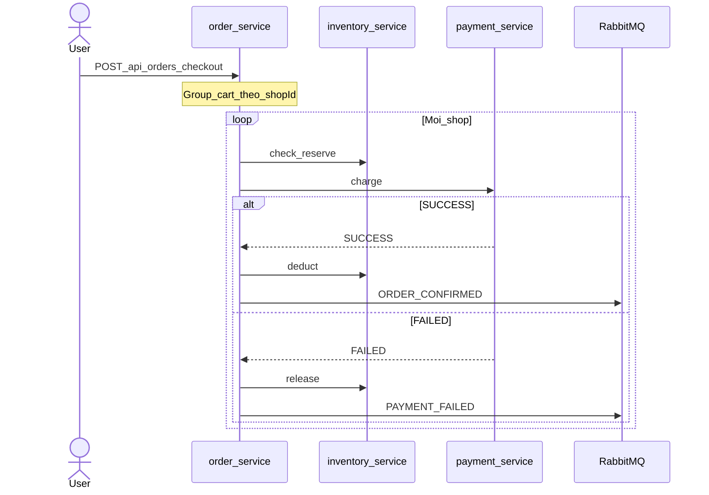

## 6.6 Hình 6.1 — ERD (Entity Relationship Diagram) logic — tổng quan

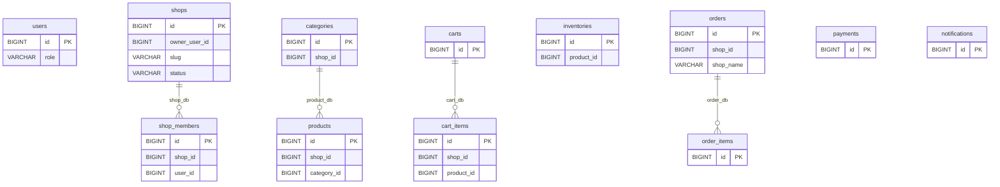

**Đọc hình:** `shop_id` trên product/cart/order là **logical ID** — không FK sang `shop_db`. FK chỉ nội bộ từng Logical database.

---

# 7. Thiết kế dữ liệu và API

## 7.1 Logical databases

| Database | Service | Bảng chính |
|----------|---------|------------|
| auth_db | auth-service | users (`role`: CUSTOMER / SELLER / PLATFORM_ADMIN) |
| shop_db | shop-service | shops, shop_members |
| product_db | product-service | categories (`shop_id`), products (`shop_id`) |
| cart_db | cart-service | carts, cart_items (`shop_id`) |
| inventory_db | inventory-service | inventories (`product_id`) |
| order_db | order-service | orders (`shop_id`, `shop_name`), order_items (Snapshot) |
| payment_db | payment-service | payments |
| notification_db | notification-service | notifications |

### Hình 7.1 — ERD (Entity Relationship Diagram / Sơ đồ quan hệ thực thể) theo từng Logical database

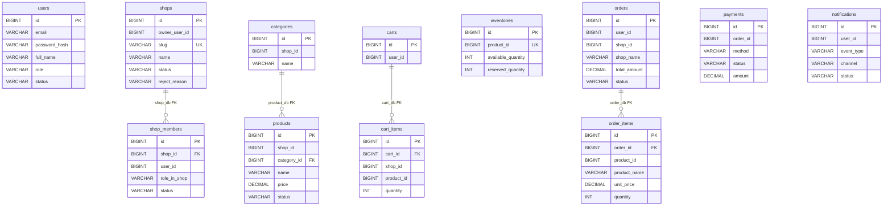

**Đọc hình**

- Mỗi nhóm bảng thuộc **một** Logical database; chỉ quan hệ có nhãn `FK` mới là khóa ngoại thật trong DB đó.
- `owner_user_id`, `shop_id` trên product/cart/order, `product_id` trên inventory/payment liên quan là **logical ID** (không FK xuyên service).
- Giá sản phẩm / `unit_price` / `total_amount` / `amount` theo **VND**.

### shop_db.shops

| Column | Ghi chú |
|--------|---------|
| id | PK |
| owner_user_id | Auth user id — no FK |
| slug | UNIQUE — định danh hồ sơ; Storefront điều hướng bằng `id` |
| name, description, logo_url | Hồ sơ gian hàng |
| status | PENDING / APPROVED / REJECTED / SUSPENDED |
| reject_reason | Khi REJECTED |
| created_at, updated_at | |

### shop_db.shop_members

| Column | Ghi chú |
|--------|---------|
| shop_id, user_id | Unique cặp |
| role_in_shop | OWNER / STAFF |
| status | ACTIVE / REVOKED |

## 7.2 API chính (qua Gateway)

| Nhóm | Method + path |
|------|----------------|
| Auth | `POST /api/auth/register`, `POST /api/auth/login`, `GET /api/auth/profile` |
| Shop public | `GET /api/shops?status=APPROVED&q=`, `GET /api/shops/id/{id}` (chi tiết theo mã); `GET /api/shops/{slug}` (phụ, hồ sơ) |
| Đăng ký shop | `POST /api/shops`, `GET /api/shops/me` |
| Admin shop | `PATCH /api/admin/shops/{id}/approve\|reject\|suspend` |
| Catalog trong shop | `GET /api/products/categories?shopId=`, `GET /api/products?shopId=&categoryId=` |
| Seller catalog | `POST/PUT/DELETE` category & product scoped shop |
| Cart | `GET /api/cart`, `POST/PUT/DELETE /api/cart/items` |
| Order | `POST /api/orders` (checkout → danh sách Order), `GET /api/orders`, cancel |
| Seller / Admin order | Đơn theo `shopId` / toàn sàn |
| Payment | `POST /api/payments` (nội bộ Saga) |
| Inventory nội bộ | `POST /internal/inventory/check\|reserve\|release\|deduct` |

Envelope:

```json
{ "success": true, "message": "Success", "data": {} }
```

---

# 8. Kịch bản kiểm thử và thuyết minh bảo vệ

## 8.1 Mở shop + mua hàng (~8 phút)

1. User đăng ký / login → **Đăng ký shop** (PENDING).
2. Platform Admin **approve** → shop hiện trên **Home**.
3. Seller vào **Kênh người bán** → tạo **category** + **product** + tồn kho.
4. Customer mở Home → chọn shop (`/shops/{id}`) → thấy **list SP** → (tuỳ chọn lọc category) → chi tiết SP → thêm giỏ.
5. (Tuỳ chọn) thêm SP shop thứ hai → giỏ **hai block shop**.
6. Checkout → **hai Order** (nếu hai shop) → payment SUCCESS → CONFIRMED.
7. Xem Notification / trạng thái đơn; Seller thấy đơn shop mình.

## 8.2 Thanh toán thất bại (~2 phút)

1. Checkout một shop với nhánh payment FAILED (hệ thống / API).
2. Stock **Release**; Order = `PAYMENT_FAILED`.

## 8.3 Từ chối / khóa shop (~1 phút)

1. Admin reject hoặc suspend → shop **không** còn trên Home; không bán.

## 8.4 Checklist thao tác Storefront (UI)

| # | Thao tác trên Nava | Route / màn hình | Kỳ vọng |
|---|-------------------|------------------|---------|
| UI-01 | Golden Path mua | `/` → `/shops/{id}` → PDP → `/cart` → `/checkout` | N Order nếu N shop; chuyển Order detail |
| UI-02 | Seller pending | `/register-shop` → `/seller` | Thấy trạng thái PENDING, chưa tab CRUD |
| UI-03 | Admin duyệt | `/admin` | Approve → shop xuất hiện Home (`/`) |
| UI-04 | Payment fail demo | `/checkout` + `simulatePaymentFailure` | Order `PAYMENT_FAILED`; thông báo |
| UI-05 | Seller không mua | Login seller → `/cart` | Redirect `/seller`; header không giỏ |
| UI-06 | Đơn bán | `/seller/orders` → chi tiết | `/seller/orders/:id?shopId=` — timeline + line items |
| UI-07 | Duyệt + email | Admin approve | Toast contactEmail; log `[MOCK EMAIL]` hoặc Brevo |
| UI-08 | Admin shop detail | `/admin/shops/:shopId` | Doanh thu GMV shop + danh sách SP xem nhanh |
| UI-09 | Theme | Admin vs Seller vs Home | Sidebar xanh vs teal vs storefront cam |
| UI-10 | Ba cổng login | Home → `/login`, `/seller/login`, `/admin/login` | Đúng role sau đăng nhập |
| UI-11 | Khóa khách | Admin tab Khách hàng → Khóa | `INACTIVE` không login |
| UI-12 | Sandbox | Seller gõ `/shops/1` hoặc `/` | Redirect `/seller` |
| UI-13 | Sandbox | Admin gõ `/` hoặc `/login` | Redirect `/admin` |

## 8.5 Checklist bảo vệ

| Câu hỏi | Trả lời gọn |
|---------|-------------|
| Vì sao tách shop-service? | Vòng đời duyệt shop khác catalog; Bounded context riêng. |
| Home hiện gì? | List shop APPROVED — không phải list SP toàn sàn. |
| Customer mua thế nào? | Vào shop theo `shopId` → list SP → giỏ → checkout. |
| Giỏ nhiều shop? | Group theo shop; N Order; mỗi Order một Saga. |
| Oversell? | Reserve trước pay. |
| Payment fail? | Release; `PAYMENT_FAILED`. |
| FE gọi đâu? | Chỉ API Gateway. |
| Có cổng thanh toán thật? | Không — Mock payment. |
| Vì sao URL dùng `shopId`? | Ổn định khi đổi tên shop; slug chỉ là hồ sơ. |
| MVP vs production? | MVP: Compose dev; prod: migration DB, Outbox, idempotent checkout, CI/CD rolling — mục 5.7. |
| Vì sao chưa Kafka? | Một consumer Notification; RabbitMQ đủ; Kafka khi cần replay/đa consumer. |

---

# 9. Kết luận

Đồ án xây **Nava** — marketplace nhiều gian hàng theo **Microservices** (MVP): đăng ký / duyệt shop, Home list shop, mua trong shop (list SP theo `shopId`), giỏ group shop, checkout split Order + Saga, giá VND.

Tám business service (+ Gateway, Eureka): nổi bật **`shop-service`** (SoT gian hàng) và **`order-service`** (Saga Orchestrator). Database per service; `shopId` logical xuyên context.

Tài liệu đủ để thuyết trình nghiệp vụ và kiến trúc. Lộ trình go-live (migration schema, idempotent Saga, Outbox, HA DB/MQ, observability) tóm tắt tại **mục 5.7** — không đổi thiết kế bounded context hiện tại.

Các tính năng sàn nâng cao (chat, livestream, tìm toàn sàn, ví thật) nằm ngoài phạm vi MVP.

---

## Phụ lục — Q&A bảo vệ

| Câu hỏi | Trả lời gọn |
|---------|-------------|
| Marketplace khác single-store? | Nhiều shop; bắt buộc chọn shop trước khi mua. |
| shop-service làm gì? | Đăng ký, duyệt, list/chi tiết shop; SoT status. |
| Vì sao không FK product → shop? | Database per service; chỉ lưu `shopId`. |
| Category thuộc ai? | Thuộc shop (`categories.shop_id`); lọc trên list SP. |
| Split Order là gì? | Mỗi shop một Order; Saga và payment riêng. |
| Ai duyệt shop? | Platform Admin qua `shop-service`. |
| Notification lỗi mất đơn? | Không rollback Order — event sau commit; MQ fail có thể mất mail (Outbox ở mục 5.7). |
| Storefront điều hướng shop thế nào? | `/shops/{shopId}` — không phụ thuộc tên/slug. |
| Frontend có gọi thẳng product-service? | **Không** — chỉ `/api` qua Gateway; xem mục 5.6. |
| State phía client quản lý thế nào? | React Context (Auth, Cart, Dialog); không Redux. |

---

*Hết báo cáo. Tài liệu phản ánh thiết kế và triển khai MVP hiện tại (gồm `shop-service` và Storefront Nava).*
