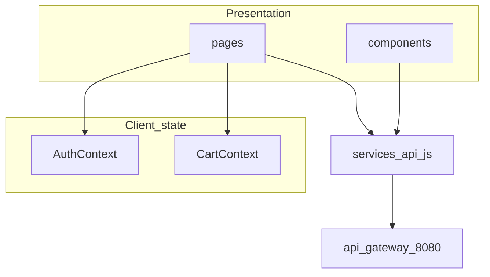
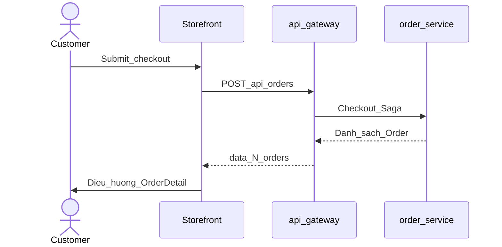

# 5. Kiến trúc Microservices

## 5.1 Lựa chọn

| | Modular Monolith | Microservices (chọn) |
|--|------------------|----------------------|
| Deploy | Một ứng dụng | Nhiều service |
| Database | Thường một DB | Database per service |
| Shop vs Catalog | Dễ dính chặt | Tách `shop-service` / `product-service` |
| Phù hợp Spring Cloud | Khó triển khai | Gateway, Eureka, MQ |

## 5.2 Vì sao chọn Microservices + tách shop-service

1. Đề tài Spring Boot + Spring Cloud.
2. **Vòng đời shop** (đăng ký, duyệt, khóa) khác **catalog** (category/SP) → Bounded context riêng.
3. Checkout cần sync Saga + async Notification.
4. Dễ bảo vệ: ownership theo `shopId`, không FK xuyên DB.
5. Hướng mở rộng: scale đọc list shop / catalog độc lập.

## 5.3 Khái niệm áp dụng

| Thuật ngữ | Trong đồ án |
|-----------|-------------|
| Bounded context | Auth, Shop, Product, Cart, Inventory, Order, Payment, Notification |
| API Gateway | `api-gateway` |
| Service Discovery | `eureka-server` |
| Database per service | Tám Logical database nghiệp vụ (+ infra) |
| Saga | Orchestration tại `order-service` (per Order / shop) |
| Eventual consistency | Notification |

## 5.4 Ưu / nhược và cách giảm phức tạp

**Ưu:** ranh giới shop rõ; duyệt shop không làm phình product-service; lỗi notification không phá Order.

**Nhược:** thêm service/DB; validate shop APPROVED khi đăng SP cần quy ước sync (gọi shop-service hoặc kiểm tra status trước khi ACTIVE).

**Giảm phức tạp MVP:** một PostgreSQL host nhiều Logical database; Mock payment; không hoa hồng / ví seller.

## 5.5 Công nghệ

| Tầng | Công nghệ |
|------|-----------|
| Backend | Java 21, Spring Boot 3, Spring Cloud, Spring Security, JPA |
| Gateway / Discovery | Spring Cloud Gateway, Eureka |
| DB | PostgreSQL — Logical database per service |
| Message | RabbitMQ |
| Frontend | React 18, Vite, React Router v6, Axios |

Storefront bổ sung: **React Context** (Auth, Cart, Dialog); **Axios interceptors** (JWT, 401, map message); dev server `:5173` proxy `/api` → Gateway (mục 5.6).

## 5.6 Thiết kế tầng giao diện (React Storefront)

### 5.6.1 Vai trò trong kiến trúc

Storefront là **SPA** — một bundle React, điều hướng phía client. Ứng dụng **chỉ biết Edge**: mọi nghiệp vụ qua `services/api.js` với `baseURL: "/api"`. Trong môi trường dev, Vite proxy tới `http://localhost:8080` (Gateway); production MVP giả định reverse proxy cùng origin — **không** gọi trực tiếp port `8081`–`8089`.

### 5.6.2 Cấu trúc mã nguồn (`frontend/src/`)

| Thư mục | Trách nhiệm |
|---------|-------------|
| `pages/` | Màn hình gắn route: Home, Shop, Cart, Checkout, Seller, Admin, Auth… |
| `components/` | `Layout` (header/nav), `ProtectedRoute`, `ProductCard`, `OrderTimeline`, `Feedback` |
| `context/` | `AuthContext` (JWT, role), `CartContext` (giỏ + badge count), `DialogContext` (confirm/toast) |
| `services/` | `api.js` — HTTP client duy nhất |
| `constants/` | Role, status, timeout, `MessageConstant` / `resolveUserMessage` |
| `utils/` | `catalog.js` (VND, nhãn trạng thái), `pendingCart`, `notifyRead` |

### 5.6.3 Xác thực và phiên

- **Login / Register:** `AuthContext` lưu `accessToken` và profile user trong `localStorage`; mọi request (trừ auth public) gắn header `Authorization: Bearer …`.
- **401:** interceptor xóa token, phát event hết phiên — tránh UI hiển thị như còn đăng nhập.
- **Phân quyền route:** `ProtectedRoute` theo role (mục 3.5); Admin không dùng giỏ Customer.

### 5.6.4 Luồng dữ liệu tiêu biểu

**Checkout (FR-07):** `CheckoutPage` lấy giỏ từ `CartContext` → `POST /orders` → điều hướng `OrderDetailPage` với `state.justPlaced` và danh sách Order (N shop → N phần tử) — khớp Saga mục 1.6.

**Giỏ đa shop:** `CartPage` group item theo `shopId`, lazy load tên shop và thông tin SP để hiển thị; **split Order** vẫn do `order-service` khi checkout.

**Hình 5.6 — Sequence UI Checkout (rút gọn)**

### 5.6.5 Xử lý lỗi và UX

- Lỗi API map sang câu tiếng Việt qua `resolveUserMessage`; UI **không** hiển thị mã lỗi thô cho end user.
- `Loading`, `Empty`, `ErrorBanner`, `ErrorBoundary` — pattern thống nhất trên pages.

### 5.6.6 Giới hạn MVP (frontend)

- Không SSR/SEO sâu; layout/style tập trung qua `Layout` và CSS class chung.
- File `ProductListPage.jsx` **legacy** — không gắn route trong `App.jsx`; luồng chính luôn qua shop (BR-MV-03).
- Admin console (`AdminLayout` + `PlatformShell`) — tổng quan GMV/doanh thu shop, duyệt gian hàng, khách hàng; catalog SP do Seller (`shopId`).

## 5.7 Giới hạn MVP và định hướng triển khai production

MVP chạy **môi trường dev** (Docker Compose, một instance/service). Kiến trúc nghiệp vụ (Gateway, database-per-service, Saga tại `order-service`, AMQP cho Notification) **đủ demo và bảo vệ**; **chưa production-grade** về HA, zero-downtime deploy và observability tập trung.

| Hạng mục | Hiện trạng MVP | Bổ sung khi go-live (ưu tiên) |
|----------|----------------|-------------------------------|
| Schema DB | JPA `ddl-auto: update` | **Flyway/Liquibase** — migration có version |
| Deploy | Script / rebuild container | **CI/CD** + **rolling update**; **readiness** tách **liveness** |
| Saga checkout | Orchestration REST + compensate | **Idempotency-Key** trên checkout; timeout + **circuit breaker** (Feign) |
| Event Notification | Publish Rabbit **sau commit** | **Transactional Outbox** + relay worker |
| HA hạ tầng | Postgres / Rabbit / Eureka single node | DB/MQ managed; backup **PITR**; discovery theo orchestrator (K8s/ECS) |
| Observability | Log + `X-Correlation-Id` | **OpenTelemetry** (trace) + **Prometheus/Grafana** (metric/SLO) |
| Edge | JWT validate tại từng service | (Tuỳ chọn) JWT/rate limit tại Gateway |

**Messaging:** giữ **RabbitMQ** cho side-effect (thông báo). Chỉ cân nhắc **Kafka** khi có nhiều consumer độc lập (audit, search, BI) cần **replay log** — ngoài phạm vi MVP Nava.

### 5.7.1 Case study ngắn (thực tế → GTVT)

**Case 1 — Marketplace: tách đơn theo seller (mô hình sàn đa gian hàng)**  
Một giỏ nhiều shop → **N đơn**; mỗi đơn một chuỗi reserve → charge → confirm; shop A lỗi thanh toán **không** rollback shop B. GTVT map trực tiếp: split Order theo `shopId` + Saga tại `order-service` (BPMN-05). Khi lên prod, rủi ro thường gặp là **retry checkout** sau timeout → cần **idempotency** và reserve/release **idempotent**.

**Case 2 — DB đã commit, message không tới (Transactional Outbox)**  
Order **COMMITTED** nhưng bước gửi RabbitMQ fail (broker/network) → khách có đơn, **không** email/thông báo. GTVT dùng publish **afterCommit** — đúng hướng tách transaction, nhưng chưa Outbox → có thể **at-most-once** trên đường MQ. Chuẩn ngành: ghi event vào bảng **outbox** cùng transaction Order; worker relay sang RabbitMQ.

### 5.7.2 So sánh messaging (tóm tắt)

| | **RabbitMQ (đồ án)** | **Kafka** |
|--|----------------------|-----------|
| Vai trò | Task queue / notify | Event log, nhiều consumer, replay |
| Phù hợp Nava | Order → Notification (một consumer) | Audit, search, analytics đa team |
| Ghi chú vận hành | Nên kèm **Outbox** + **DLQ** | Ops phức tạp hơn; không bắt buộc cho MVP |

Chi tiết kỹ thuật triển khai local: `docs/12-deployment.md`, `docs/15-spring-cloud-luong-chay-va-config.md`.

---
