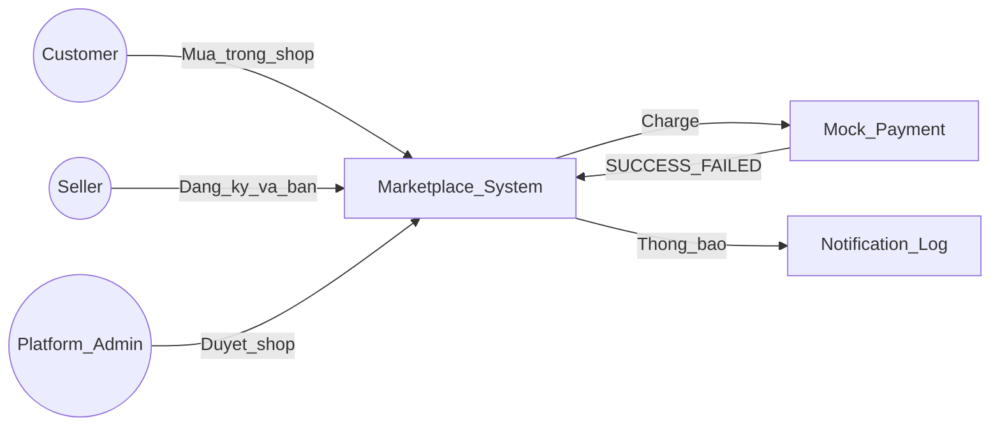
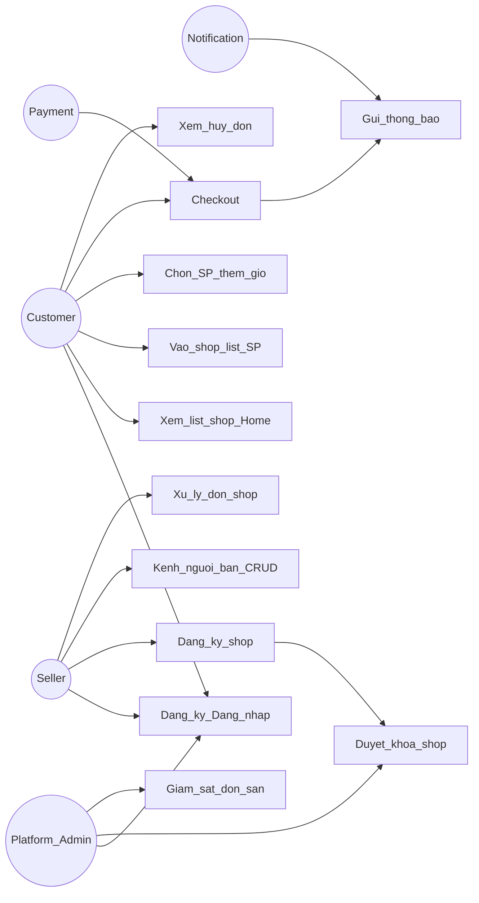
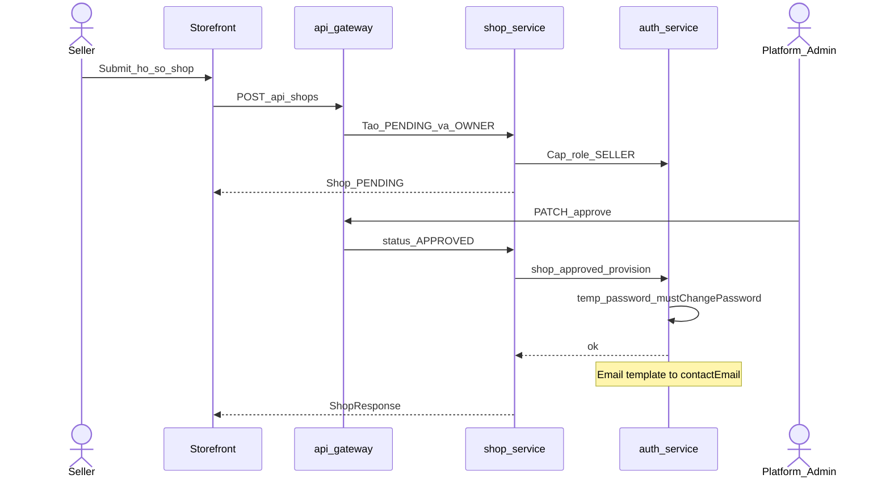
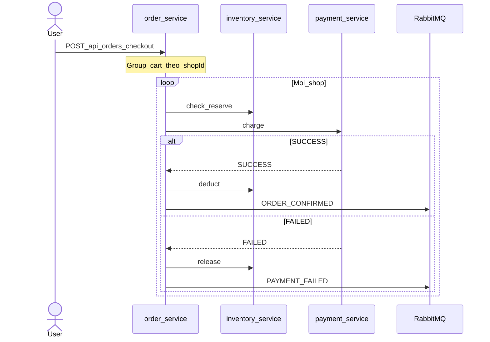
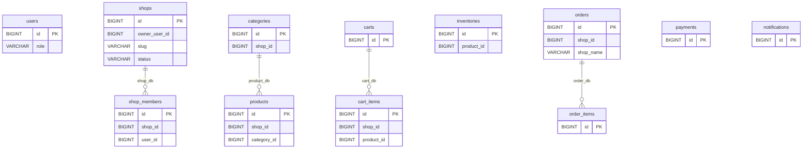

# 6. Biểu đồ thiết kế

## 6.1 Hình 2.1 — System Context

## 6.2 Hình 3.1 — Use Case

## 6.3 Deployment

**Dev (MVP hiện tại)**

- Frontend `:5173`
- Gateway `:8080`, Eureka `:8761`
- auth `:8081`, product `:8082`, cart `:8083`, inventory `:8084`, order `:8085`, payment `:8086`, notification `:8087`, **shop `:8089`** (admin-server giữ `:8088`)
- PostgreSQL `:5432`, RabbitMQ `:5672`
- Engine: `scripts/ops-deploy.sh` (Maven trong container + `docker compose up`)

**Production (định hướng — mục 5.7)**

- Storefront: build static (Vite) + CDN/reverse proxy; API chỉ qua Gateway (HTTPS).
- Microservice: orchestrator (K8s/ECS), **rolling deploy**, secret qua vault/env; **không** `ddl-auto: update` trên prod.
- Data: Postgres/RabbitMQ managed, backup có kiểm thử restore; correlation id + trace/metric tập trung.

## 6.4 Hình 5.1 — Sequence đăng ký & duyệt shop

## 6.5 Hình 5.2 — Sequence Checkout + Saga (một Order / shop)

## 6.6 Hình 6.1 — ERD (Entity Relationship Diagram) logic — tổng quan

**Đọc hình:** `shop_id` trên product/cart/order là **logical ID** — không FK sang `shop_db`. FK chỉ nội bộ từng Logical database.

---
