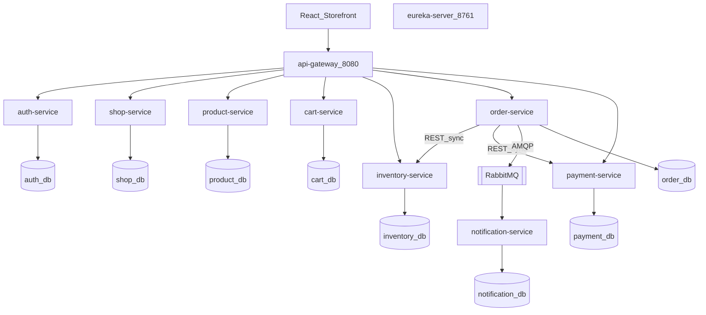
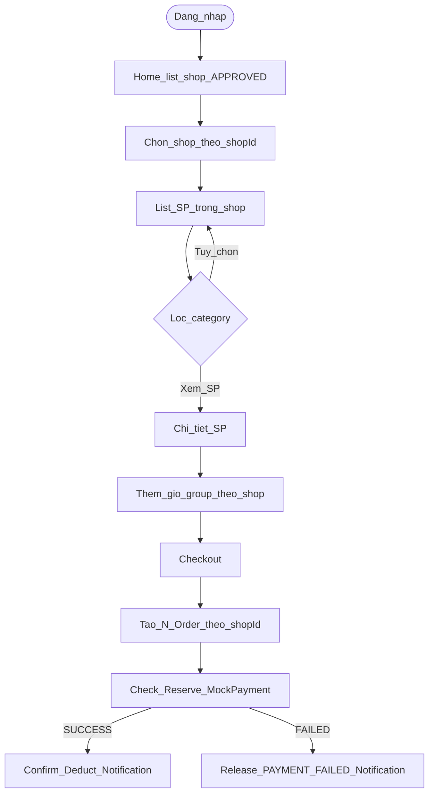
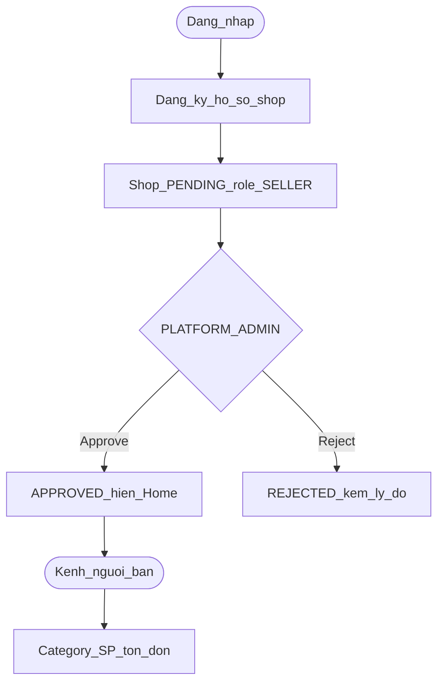

# 1. Tổng quan hệ thống

## 1.1 Hệ thống là gì

Đồ án xây **Nava** — hệ thống thương mại điện tử dạng **marketplace (nhiều gian hàng)** theo kiến trúc **Microservices** (Spring Boot + Spring Cloud), mức **MVP**.

Hệ thống cho phép:

- **Customer** xem danh sách shop trên Home, **vào một shop** (URL theo `shopId`), xem **danh sách sản phẩm** (lọc category tùy chọn), thêm giỏ (group theo shop), checkout, theo dõi / hủy đơn hợp lệ.
- **Seller** đăng ký mở shop → chờ duyệt → quản lý danh mục / sản phẩm / tồn / đơn **của shop mình** (Kênh người bán).
- **Platform Admin** duyệt / từ chối / khóa shop; **tổng quan GMV và doanh thu theo gian hàng**; quản lý khách hàng (MVP — không màn hình xử lý đơn toàn sàn trên UI).
- Thanh toán **Mock payment** theo từng Order; thông báo **bất đồng bộ** qua RabbitMQ. Giá hiển thị **VND**.

**Luồng mua chính:** Home (list shop) → chọn shop → danh sách SP trong shop → chi tiết SP → giỏ → checkout.  
Customer **không** mua từ catalog “tất cả SP mọi shop” như cửa hàng đơn.

Frontend chỉ gọi **API Gateway**. Shop là Bounded context riêng: **`shop-service`** + **`shop_db`**.

## 1.2 Hình 1.1 — Architecture overview

**Đọc hình**

- Storefront chỉ biết Gateway; Eureka cung cấp Service Discovery.
- `shop-service` là nguồn sự thật về gian hàng (đăng ký, duyệt, list Home).
- `product-service` quản lý category/SP theo `shopId` (logical ID, không FK sang `shop_db`).
- Checkout: mỗi Order thuộc một shop; Order → Inventory → Payment (Saga); sau đó event → Notification.

## 1.3 Catalog dịch vụ

| Service | Port | Logical DB | Trách nhiệm | Vai trò trong hệ thống |
|---------|------|------------|-------------|------------------------|
| `api-gateway` | 8080 | — | Route `/api/**`, CORS | **Edge** |
| `eureka-server` | 8761 | — | Đăng ký / khám phá service | **Service Discovery** |
| `auth-service` | 8081 | auth_db | Register, login, JWT; role CUSTOMER / SELLER / PLATFORM_ADMIN | **Identity & Access** |
| `shop-service` | 8089 | shop_db | Đăng ký shop, duyệt/khóa, list/chi tiết shop public | **Shop registry** — SoT gian hàng |
| `product-service` | 8082 | product_db | Category + product theo `shopId` | **Catalog trong shop** |
| `cart-service` | 8083 | cart_db | Giỏ; item kèm `shopId` | **Pre-order** (group theo shop) |
| `inventory-service` | 8084 | inventory_db | check / reserve / release / deduct | **Stock integrity** |
| `order-service` | 8085 | order_db | Split Order theo shop; Snapshot; hủy; fulfillment | **Saga Orchestrator** |
| `payment-service` | 8086 | payment_db | Mock charge SUCCESS / FAILED | **Mock payment** (per Order) |
| `notification-service` | 8087 | notification_db | Consume event | **Side-effect** async |

## 1.4 Giao tiếp sync / async

| Kiểu | Đường đi | Mục đích |
|------|----------|----------|
| Sync (REST) | Client → Gateway → Service; Order → Inventory; Order → Payment | Checkout cần kết quả ngay |
| Async (AMQP) | Order → RabbitMQ → Notification | Tách thông báo khỏi transaction đơn |

## 1.5 Information Architecture Storefront (Nava)

**Luồng mua (tóm tắt)**

| Bước | Route | Hành vi |
|------|-------|---------|
| 1 | `/` | **Danh sách shop** `APPROVED` (tên, logo, mô tả); tìm shop theo tên |
| 2 | `/shops/:shopId` | Vào **một shop** theo mã ổn định; **list SP** (lọc category tùy chọn) |
| 3 | `/shops/:shopId/products/:id` | Chi tiết SP trong context shop → thêm giỏ |
| 4 | `/cart` | Giỏ **group theo shop** (mỗi block một shop) |
| 5 | `/checkout` | Checkout → **N Order** (1 Order / shop); mỗi Order một Saga + Mock payment |

**Toàn bộ route (`App.jsx`)**

| Nhóm | Route | Bảo vệ | Mục đích |
|------|-------|--------|----------|
| Công khai | `/`, `/shops/:shopId` | — | Home, catalog trong shop |
| Công khai | `/shops/:shopId/products/:id`, `/products/:id` | — | PDP (context shop hoặc legacy) |
| Công khai | `/shops/:shopId/products` | — | Redirect legacy → `/shops/:shopId` |
| Xác thực | `/login`, `/register` | — | JWT; login có thể flush giỏ pending |
| Xác thực | `/forgot-password`, `/reset-password` | — | Khôi phục mật khẩu |
| Customer | `/cart`, `/checkout`, `/orders`, `/orders/:id` | CUSTOMER | Giỏ, checkout, đơn |
| Customer | `/notifications` | CUSTOMER | Thông báo async (badge trên Layout) |
| Chung | `/profile` | Login | Hồ sơ |
| Seller | `/register-shop` | Login | Gửi hồ sơ shop |
| Seller | `/seller` | SELLER | Kênh người bán (sau APPROVED) |
| Admin | `/admin` | PLATFORM_ADMIN | Duyệt shop, giám sát sàn |

> `shopId` dùng cho điều hướng Storefront. Trường `slug` chỉ phục vụ hồ sơ (unique), không phải khóa URL chính. Chi tiết ánh xạ FR → API: mục **3.5**; kiến trúc UI: mục **5.6**.

## 1.6 Golden Path

### Hình 1.2a — Mua hàng

**Đọc hình:** Vào shop là xem list sản phẩm; category chỉ là bộ lọc. Mỗi shop một Order và một vòng Saga riêng.

### Hình 1.2b — Mở shop

**Đọc hình:** Shop chỉ bán và hiện Home sau khi được duyệt. Seller quản lý gian hàng trong Kênh người bán.

---
