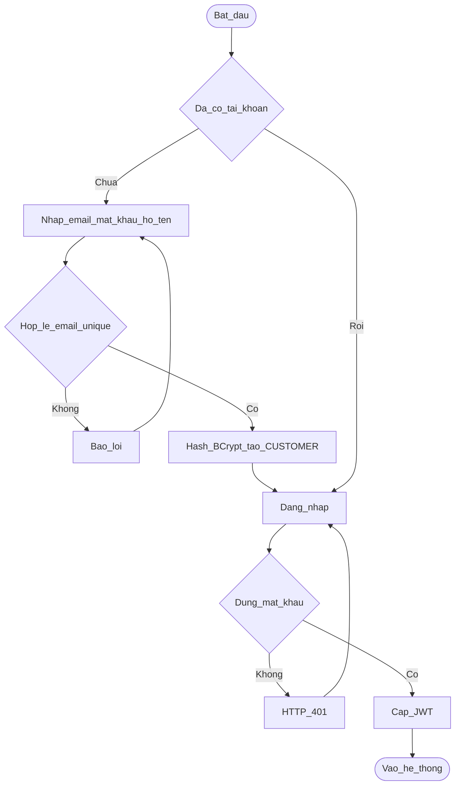
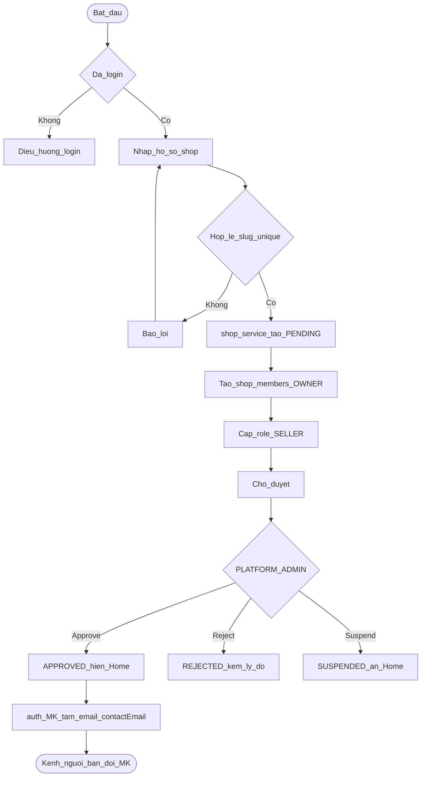
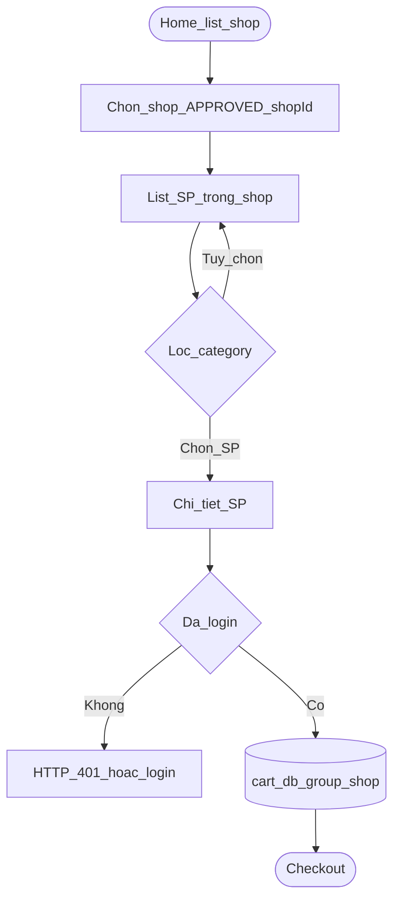
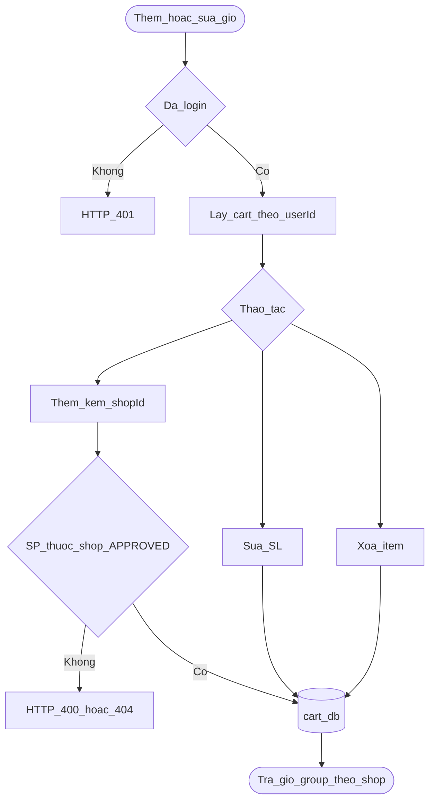
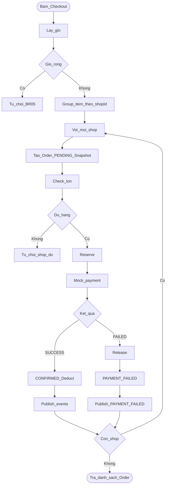

# 4. Quy trình nghiệp vụ (BPMN)

## 4.1 BPMN-01 — Đăng ký / Đăng nhập

**Đọc hình:** JWT mang `userId` + `role` (CUSTOMER / SELLER / PLATFORM_ADMIN).

## 4.2 BPMN-02 — Đăng ký shop và duyệt (trọng tâm marketplace)

**Hình 4.1 — Đăng ký & duyệt shop**

**Đọc hình**

- `shop-service` tạo shop `PENDING`; chưa hiện Home; hồ sơ có `contactEmail`.
- Approve → `APPROVED` + gọi `auth-service` (mật khẩu tạm, `mustChangePassword`) + email template tới `contactEmail` (best-effort).
- Seller đăng nhập lần đầu → `/change-password` → `/seller` (dashboard merchant).
- Reject / Suspend → **không** gửi email credential; Customer không thấy shop trên Home.

## 4.3 BPMN-03 — Mua hàng trong shop (Home → shop → list SP)

**Hình 4.2 — Hành trình mua trên Storefront**

**Đọc hình:** Home không liệt kê SP thay shop. Vào shop theo `shopId` là thấy list SP; category là bộ lọc tùy chọn.

## 4.4 BPMN-04 — Giỏ hàng

Mỗi Customer một giỏ. Item lưu `shopId`. UI group theo shop.

## 4.5 BPMN-05 — Checkout + Saga (split theo shop)

**Hình 4.3 — Checkout split N Order**

**Đọc hình**

- Một request checkout có thể tạo **nhiều Order**; mỗi Order một Saga độc lập.
- Fail một shop không bắt buộc rollback shop khác (MVP: mỗi shop xử lý riêng; báo rõ từng Order).
- `order-service` = Saga Orchestrator; không 2PC xuyên DB.

### Fulfillment (rút gọn)

Seller (hoặc Platform Admin) đổi PROCESSING → SHIPPING → DELIVERED cho Order của đúng shop; có thể publish event Notification.

---
