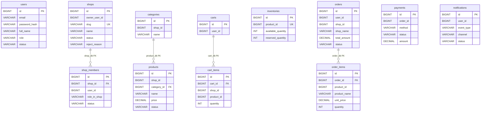

# 7. Thiết kế dữ liệu và API

## 7.1 Logical databases

| Database | Service | Bảng chính |
|----------|---------|------------|
| auth_db | auth-service | users (`role`: CUSTOMER / SELLER / PLATFORM_ADMIN) |
| shop_db | shop-service | shops, shop_members |
| product_db | product-service | categories (`shop_id`), products (`shop_id`) |
| cart_db | cart-service | carts, cart_items (`shop_id`) |
| inventory_db | inventory-service | inventories (`product_id`) |
| order_db | order-service | orders (`shop_id`, `shop_name`), order_items (Snapshot) |
| payment_db | payment-service | payments |
| notification_db | notification-service | notifications |

### Hình 7.1 — ERD (Entity Relationship Diagram / Sơ đồ quan hệ thực thể) theo từng Logical database



**Đọc hình**

- Mỗi nhóm bảng thuộc **một** Logical database; chỉ quan hệ có nhãn `FK` mới là khóa ngoại thật trong DB đó.
- `owner_user_id`, `shop_id` trên product/cart/order, `product_id` trên inventory/payment liên quan là **logical ID** (không FK xuyên service).
- Giá sản phẩm / `unit_price` / `total_amount` / `amount` theo **VND**.

### shop_db.shops

| Column | Ghi chú |
|--------|---------|
| id | PK |
| owner_user_id | Auth user id — no FK |
| slug | UNIQUE — định danh hồ sơ; Storefront điều hướng bằng `id` |
| name, description, logo_url | Hồ sơ gian hàng |
| status | PENDING / APPROVED / REJECTED / SUSPENDED |
| reject_reason | Khi REJECTED |
| created_at, updated_at | |

### shop_db.shop_members

| Column | Ghi chú |
|--------|---------|
| shop_id, user_id | Unique cặp |
| role_in_shop | OWNER / STAFF |
| status | ACTIVE / REVOKED |

## 7.2 API chính (qua Gateway)

| Nhóm | Method + path |
|------|----------------|
| Auth | `POST /api/auth/register`, `POST /api/auth/login`, `GET /api/auth/profile` |
| Shop public | `GET /api/shops?status=APPROVED&q=`, `GET /api/shops/id/{id}` (chi tiết theo mã); `GET /api/shops/{slug}` (phụ, hồ sơ) |
| Đăng ký shop | `POST /api/shops`, `GET /api/shops/me` |
| Admin shop | `PATCH /api/admin/shops/{id}/approve\|reject\|suspend` |
| Catalog trong shop | `GET /api/products/categories?shopId=`, `GET /api/products?shopId=&categoryId=` |
| Seller catalog | `POST/PUT/DELETE` category & product scoped shop |
| Cart | `GET /api/cart`, `POST/PUT/DELETE /api/cart/items` |
| Order | `POST /api/orders` (checkout → danh sách Order), `GET /api/orders`, cancel |
| Seller / Admin order | Đơn theo `shopId` / toàn sàn |
| Payment | `POST /api/payments` (nội bộ Saga) |
| Inventory nội bộ | `POST /internal/inventory/check\|reserve\|release\|deduct` |

Envelope:

```json
{ "success": true, "message": "Success", "data": {} }
```

---
